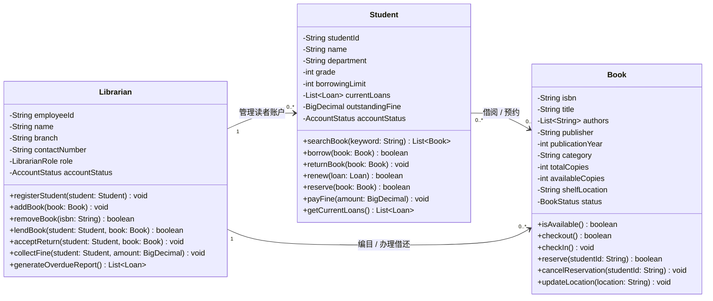

# 作业 1：图书馆借书、还书场景 UML 建模

## 题目

以“图书馆借书、还书”为场景，为大学里的学生、书籍和大学图书馆的管理员各设计一个类，并定义相关属性和方法。

## 类图

## 设计说明

- **Student（学生）**：保存学生身份、借阅上限、当前借阅、欠费和账户状态，并提供检索、借书、还书、续借、预约与缴费行为。
- **Book（书籍）**：保存图书的书目信息、馆藏数量、可借数量、馆藏位置和状态，并负责借出、归还、预约等状态变更。
- **Librarian（图书馆管理员）**：维护学生账户和馆藏，办理借还书、收取逾期费用，并生成逾期报告。

`Student` 与 `Book` 之间是多对多的借阅或预约关系；`Librarian` 负责管理多个学生账户和多本书籍。实际系统中可通过 `Loan` 对象记录每次借阅的日期、到期日和归还状态。

## 文件

- [`assignment1.puml`](assignment1.puml)：可编辑的 PlantUML 源文件。
- [`assignment1.svg`](assignment1.svg)：导出的 UML 类图，可直接预览。
- [`assignment1.png`](assignment1.png)：PNG 格式的 UML 类图，便于下载或插入文档。
