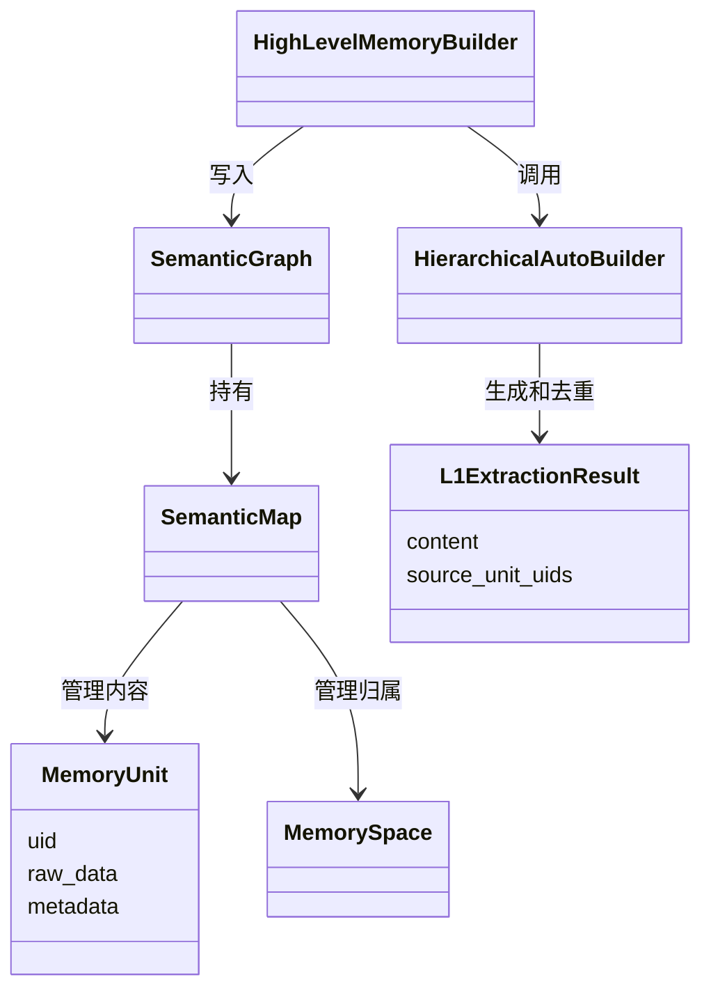
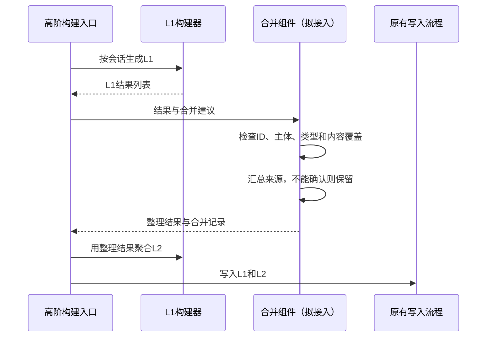

# Mandol 超长记忆增强大作业阶段报告

## 1. 目前的选题想法

我选择的是 Mandol 智能体记忆系统的超长记忆增强方向。目前准备研究近重复记忆的合并，暂定题目为“Mandol 中面向信息保留和来源追溯的近重复记忆合并改进”。

长期对话中，同一件事情经常被反复提到，但每次说法不完全一样，有时还会补充一些信息。如果全部保存，记忆会越来越多；如果简单删掉相似内容，又可能把有用的细节一起删掉。因此，我希望在原有去重流程上做一些改进，让合并更保守，并保留原始来源。

本阶段完成了源码阅读、受控小实验和初步设计，随后补做了离线对照及真实模型组件评测，见第8节。完整系统接入仍未完成。第4节保留的是最初的受控实验，不应作为最终效果结论。

## 2. 目标系统理解

### 2.1 版本和代码结构

本次固定使用官方仓库 https://github.com/AgentCombo/Mandol 的提交 `6d7af4f004e1b311fb5c93d3e14fab90677942d8`。这个版本的包版本号是 0.1.0，Python 要求为 3.12。代码已经下载到本地，并建立了基线标签，方便后续比较修改前后的结果。

相关代码主要分为几部分：

| 模块 | 我的理解 |
|---|---|
| `core` | 定义记忆对象，管理内容、空间、索引和图关系 |
| `auto_builder` | 从基础记忆生成摘要、事件及实体关系 |
| `retrieval` | 提供向量、BM25、SPLADE 等检索和排序方法 |
| `hierarchical`、`episodic`、`entity_relation` | 分别检索分层记忆、情景记忆和实体关系记忆 |
| `triple_retrieval` | 组织三种记忆的检索流程 |
| `memory_router`、`quantification` | 路由查询、筛选候选并控制上下文长度 |
| `storage` | 配合 RocksDB 管理常驻和冷数据 |

### 2.2 核心对象

`MemoryUnit` 是一条记忆，包含 UID、实际内容、元数据和向量等。原始对话和摘要都可以使用这个对象表示。

`MemorySpace` 主要保存记忆 UID 的归属和子空间关系，不是每个空间单独复制一套文本和向量。

`SemanticMap` 管理记忆内容、空间和检索索引，`SemanticGraph` 在它之上管理节点和关系。两者是组合关系。

`HighLevelMemoryBuilder` 组织高阶记忆构建，`HierarchicalAutoBuilder` 负责其中的分层摘要。`L1ExtractionResult` 保存生成的摘要，其中的 `source_unit_uids` 可以记录摘要来自哪些基础记忆。

下面只画与本任务最有关的对象，没有列出所有成员：



### 2.3 主要执行流程

写入时，调用者创建 `MemoryUnit`，通过 `SemanticGraph.add_unit()` 交给 `SemanticMap` 生成向量、保存内容并更新空间和索引，随后图对象更新对应节点。写入本身不等于完成高阶摘要构建。

高阶构建的一个入口是 `HighLevelMemoryBuilder.build_from_l0_units()`。它按会话组织基础记忆，依配置构建分层、情景和实体关系记忆。与本课题有关的分层流程是：

```text
按会话组织 L0 → 提取 L1 → 可选的 L1 去重 → 聚合 L2 → 写入系统
```

构建任务可以并行生成结果，通过 `GraphWriteQueue` 批量写入，减少多个工作线程直接修改共享图。

检索时，`MultiRetriever` 协调向量、关键词等方法；`TripleTowerRetriever` 协调三类记忆。当前同步流程是路由、各塔检索、汇集候选、筛选和组织上下文，再统一重排序。回答生成还需要由应用调用回答模型。

系统已有冷热分页，但换出 payload 时仍保留索引和图拓扑，所以分页不等于删除重复记忆，也不能直接说明总数据量减少。另外，摘要层的 L1/L2 与存储层的 L1/L2 不是同一含义。

## 3. 现有去重处理和问题

主要查看的方法是 `auto_builder/hierarchical_builder.py` 中的 `deduplicate_l1()`，它在去重开关启用时才运行。

这个方法先按摘要类型分组，将每条摘要的前 500 个字符提交给模型，解析返回的 `unique_items` 和 `merged_items`。对于合并组，它取 `merged_from` 中的第一个 ID，最后保留这个 ID 对应的原结果。

我目前关注三个问题：

1. 只保留第一项，可能没有保留其他项补充的信息。
2. 被合并项的来源列表没有在这个方法中汇总，保留结果可能无法表示全部来源。
3. 如果返回的 ID 不完整或包含未知 ID，程序可能丢弃本应保留的输入。

这里不能直接得出“真实模型经常出错”的结论，也不代表整个系统没有其他去重能力。它只是说明这段后处理逻辑值得单独验证。

## 4. 本阶段的小实验

### 4.1 实验做法

目前没有完整配置 Mandol 的模型和运行环境，所以先做受控实验。脚本从源码中提取原方法执行，用固定 JSON 代替模型返回，观察后处理结果。模型调用、提示词和解析协作者使用了替代实现，没有运行真正的模型推理。

共准备 15 组人工样例，包括完全重复、空格差异、信息补充、近义表达、否定差异、数字差异、时间更新、不同用户、不同摘要类型、结构化内容、500 字符后的区别，以及漏列输入、未知 ID、重复 ID 等异常情况。若干固定合并建议是故意构造的错误建议，用来检查保护机制。

检查了输出条数、来源覆盖和字面分句覆盖。来源覆盖是输出中能找到的原始来源 ID 比例；字面分句覆盖是简单按分号、句号和换行切分后匹配的结果，不代表真正的语义正确率。不同用户的相同文本也可能被这个指标当作相同，所以还要单独检查用户和预期输出 ID。

### 4.2 几个有代表性的结果

| 样例与固定建议 | 原方法结果 | 保守原型结果 |
|---|---|---|
| 两条完全相同的记忆，建议合并 | 留一条，但来源覆盖为 50% | 留一条并汇总双方来源 |
| A 为“周五去上海”，B 还补充“周日返回”，建议保留 A 对应合并组 | 留下 A，字面分句覆盖为 50% | 选择覆盖更多分句的 B，并汇总来源 |
| “喜欢辣”和“不喜欢辣”被错误建议合并 | 留第一条 | 不接受合并，保留两条 |
| 返回的合并组第一个 ID 不存在 | 输出为空 | 整份建议回退，保留输入 |
| 两条摘要前 500 字相同，后面的预算不同 | 模型输入看不到后面的差别；固定合并建议下留第一条 | 检查完整内容后拒绝合并 |

15 组样例中的预期输出、输入对象不被修改、来源和字面分句覆盖检查均已通过。原型在这些样例中的来源和字面分句覆盖都是 100%，但这是保守规则和特意设计样例下的结果，不能作为通用算法准确率。

完整输入、固定返回值和输出见 `results/controlled_results.json`，汇总表见 `results/实验结果.md`。目前还没有测真实检索质量、内存占用和模型调用成本。

## 5. 需求和初步改进方案

### 5.1 处理范围

第一版先处理普通文本形式的 L1，不处理结构化 JSON，也不修改已经落盘的历史图。相同主体和相同摘要类型是允许合并的前提。用户身份缺失时先保留，后续需要补充与真实数据中主体字段的对应关系。

完全相同的内容可以保留一条；如果一条内容按简单分句后覆盖另一条的全部信息，可以选择更完整的一条。语义相近但不能确定、出现冲突或时间变化时先不合并。

来源不是只保留代表条目的来源，而是汇总整个合并组，同时记录原摘要 ID 和会话 ID。这里记录的是元数据，不应直接当作已经建立了图上的来源边。

### 5.2 对象职责

| 对象 | 负责什么 | 当前进度 |
|---|---|---|
| `Summary` | 实验中使用的摘要数据，字段对应 L1 结果 | 已实现，后续换成原项目类型 |
| `ConservativeMerger` | 检查合并建议，保守判断能否合并 | 已有独立原型 |
| `MergePlan` | 记录代表 ID、成员、来源和理由 | 已实现 |
| 候选发现与语义判定组件 | 缩小比较范围，处理不同说法 | 只完成思路，未实现 |
| 写入适配 | 把原型结果接回 L1、L2 构建流程 | 未实现 |

当前原型把判定和结果构造放在一起，便于先验证思路；后续接入时再根据实际复杂度拆分，不先增加很多空接口。



### 5.3 为什么暂时不直接生成新摘要

我也考虑过把多条记忆交给模型重新写成一条短摘要。这样能处理更多不同说法，但也可能新增错误，事实是否保留比较难检查。因此第一步先选择已有内容作为代表，暂不自由生成融合文本。受约束摘要压缩可以作为后续扩展，不作为当前主任务。

### 5.4 可能的问题

字面包含规则比较简单，很多同义表达不会合并；按标点分句也不能可靠理解所有条件句，因此只能作为初步原型。来源元数据会变大，保留原始 L0 时总存储未必明显下降。若以后真正删除历史节点，还要处理索引、关系和来源引用，不能只删列表元素。

## 6. 后续验证和时间安排

第 8、9 周先提交本报告、小实验结果及初步设计，课堂上主要讲问题、证据和准备怎么改。

之后准备先把处理流程接入 L1 去重位置，并保留原开关或增加策略选择。再加入真实模型、手工标注的独立样本，比较不去重、原有去重和改进去重。除了条数，还要记录误合并、事实遗漏、来源完整性、运行耗时和调用成本。还要检查去重后的 L2 是否变化、保存恢复是否正常，以及检索能否找到相应证据。

第 13 周争取形成可运行的初步实现，记录失败案例和修改过程。更大规模实验和最终报告留到后续阶段。

## 7. 大模型辅助和自己的核对

本阶段使用大模型帮助梳理代码和提出方案，没有把生成的说明直接当作结论。例如，开始讨论过 `MemorySystem` 的用法，查看当前源码后改为以 `SemanticGraph` 和 `SemanticMap` 为核心理解；也确认原系统已有摘要和分页，不能把这些能力写成自己新增的内容。

对于去重问题，最初只有“可能丢信息”的判断，之后通过读取实际方法并注入固定返回值，确认了特定输入下的行为。但真实模型产生这些返回值的频率还不清楚，报告中暂不写成实际系统性能结论。

目前的想法是先把范围控制住，做清楚一次合并应该保留哪些信息，再考虑更复杂的语义合并。

## 8. 补充的小规模评测与判断修正

之前15组样例的模型返回值是固定的，主要用于找后处理问题。后来增加了48组合成样例，分为8类，每类6组，包括完全重复、包含、近义表达、否定、数字、时间、不同用户和条件范围。每类2组用于开发，4组用于评测，所以评测集共有32组。每组交换输入顺序检查一次，不能把两种顺序算成独立样例。

数据和事实ID先写入文件，算法不读取能否合并的标签来决策。阈值仅在开发集从0.3、0.5、0.7、0.9中选择，最终为0.5。这些标注还是AI给出的初始标注，没有经过独立人工复核，也不是外部真实数据集；共同模板还可能让评测偏简单。

### 8.1 不使用模型的离线比较

比较全部保留、精确去重并汇总来源、字面候选加原后处理、相同候选加保守原型四种方法。原后处理和原型收到相同的自动候选建议，不再为每组预设合并答案。

| 方法 | 合并精确率 | 合并召回率 | 不可合并样例误合并率 | 标注事实保留 |
|---|---:|---:|---:|---:|
| 全部保留 | 不适用 | 0.0% | 0.0% | 100.0% |
| 精确去重 | 100.0% | 33.3% | 0.0% | 100.0% |
| 字面候选加原后处理 | 41.2% | 58.3% | 50.0% | 82.0% |
| 相同候选加保守原型 | 77.8% | 58.3% | 10.0% | 96.9% |

这里的“原后处理”不是原项目真实模型的完整去重效果。这个比较主要说明，简单候选规则可能误判，而保守检查也没有解决所有问题。

### 8.2 真实模型调用

使用 qwen3.6-flash 和原项目去重提示词，温度0.1，输出上限1000，关闭思考，32组评测样例正反顺序共64次请求。每次返回同时交给原后处理和保守原型，规则不根据本轮结果修改。调用参数、回答、响应ID、文件哈希及用量已经保存，密钥没有写入文件。

64次接口请求都成功，但其中22次的 `unique_items` 返回对象列表，而提示词要求字符串ID列表。按照事先约定的严格格式筛选，只有42次有效。因此严格口径存在明显的样本选择风险，不适合只挑这部分分数证明方案有效。完整严格结果保存在 `results/real_model/真实模型评测结果.md`。

随后增加了一项事后补充回放：把全部64份回答直接交给原代码，不做格式转换。原代码会跳过非字符串的unique项，并在没有保留ID时回退。这个补充分析执行时没有异常，但它不能替换事先约定的严格分析。

全部返回的补充结果如下：

| 方法 | 合并精确率 | 合并召回率 | 不可合并样例误合并率 | 标注事实保留 | 来源覆盖 | 文本字符减少 |
|---|---:|---:|---:|---:|---:|---:|
| 真实返回加原后处理 | 60.0% | 100.0% | 40.0% | 82.8% | 68.8% | 32.3% |
| 同一返回加保守原型 | 66.7% | 66.7% | 20.0% | 93.8% | 100.0% | 14.4% |

来源覆盖只是来源ID的保留，不代表每个来源都支持输出中的每个事实。字符减少不包括向量、图、来源字段和原始L0，不能写成节省了同样比例的内存。本轮共计量28047 tokens，没有估算金额。没有测L2、保存恢复和最终问答。

### 8.3 原型还有什么问题

最明显的失败是条件范围。例如“用户取消出行”和“如果下雨；用户取消出行”，按分句包含可以把前一条看成后一条的一部分，但两条的实际意思并不一样。这次真实返回回放中，保守原型仍错误合并了4组条件样例，正反顺序各出现一次。

因此，原来“字面覆盖就可以安全合并”的想法还不够。下一版需要把条件、例外、否定和时间范围作为单独检查项，并在新数据上验证。当前先保留失败结果，不直接针对这4组改完规则后再宣称解决了问题。

目前更合适的结论是：汇总来源和保守检查有进一步研究的价值，但会牺牲一部分合并机会，简单分句规则还不可靠。真实调用让问题更具体了，还不足以证明整个系统有稳定收益。

## 参考材料

- 根目录《课程大作业说明 20260911 (1).pdf》第 1—3 页。
- 固定版本 `src/mandol/core/` 下的记忆对象、空间、Map 和 Graph 实现。
- `src/mandol/auto_builder/high_level_memory.py`、`hierarchical_builder.py`、`graph_write_queue.py`。
- `src/mandol/triple_retrieval/triple_tower_retriever.py` 与 `storage/tiered_storage_manager.py`。

日期：2026 年 10 月 23 日。
